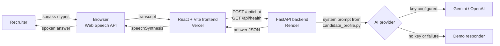

# Personal AI Assistant — Akshat Bhardwaj's AI twin

A public web app where a recruiter can **speak or type interview questions** and get natural, first-person answers grounded only in Akshat Bhardwaj's verified CV. Built for the 100x recruitment assessment ("Meet My AI Twin").

No login, no install, no API key entry for the recruiter. Voice runs in the browser; answers come from a FastAPI backend that uses Gemini or OpenAI when a key is configured, and a clearly labelled **demo mode** when it isn't.

## The problem it solves

Recruiters want a fast, conversational way to learn about a candidate before a call. Written profiles are static; a chatbot that invents facts is worse than nothing. This app gives a spoken, interview-style conversation that answers directly, stays consistent across follow-ups, and says "that's not covered in my profile" instead of fabricating employers, metrics or stories.

## Goals and key features

- **Voice in, voice out** — browser speech recognition and speech synthesis, with listening / thinking / speaking states, stop, replay and mute.
- **Text everywhere** — typed questions and readable answers as a fallback in every browser.
- **Personalised AI answers** — first person, 50–120 words, confident and honest, built from a single editable candidate profile.
- **Demo mode** — works with zero credentials; keyword-routed answers from the same CV facts, labelled in the UI.
- **Safe backend** — validation, size limits, history trimming, per-IP rate limiting, explicit CORS, timeouts, graceful fallback.
- **Accessible** — keyboard operable, labelled controls, visible focus, live-region status, reduced-motion support, responsive down to phone width.
- **Private** — no storage, no cookies, no audio upload, no contact details in the UI, no secrets in the frontend.

## Technology stack

| Layer | Choice | Version |
|---|---|---|
| Frontend | React, TypeScript, Vite, Tailwind CSS | React 19, TS 7, Vite 8, Tailwind 4 |
| Frontend tests | Vitest, Testing Library, jsdom | Vitest 5 |
| Lint | oxlint (frontend), ruff (backend) | |
| Backend | Python, FastAPI, Pydantic v2, pydantic-settings, httpx, uvicorn | Python 3.12, FastAPI 0.115 |
| Backend tests | pytest | 8.3 |
| AI | Google Gemini (`gemini-2.0-flash`) or OpenAI (`gpt-4o-mini`) via REST, or demo responder | configurable |
| Voice | Web Speech API (`SpeechRecognition`, `speechSynthesis`) | browser |
| CI | GitHub Actions | |

## Architecture



The frontend only knows the backend URL. The backend holds the provider key, builds the system prompt from `backend/app/knowledge/candidate_profile.py`, and returns `{answer, provider, demo_mode}`. Full details and a sequence diagram: [docs/ARCHITECTURE.md](docs/ARCHITECTURE.md).

## Repository structure

```
100x-ai-voice-interview-agent/
├── frontend/
│   ├── src/
│   │   ├── components/   Button, MessageList, QuestionInput, VoiceControls, StatusIndicator,
│   │   │                 SuggestedQuestions, ConfirmDialog, PrivacyNotice
│   │   ├── pages/        LandingPage, InterviewPage
│   │   ├── hooks/        useInterview, useSpeechRecognition, useSpeechSynthesis
│   │   ├── services/     api.ts (fetch wrapper for /api/chat and /api/health)
│   │   ├── types/        chat.ts
│   │   └── config/       app.ts (names, suggested questions, API base URL)
│   ├── tests/            Vitest tests + setup
│   ├── index.html, vite.config.ts, package.json, .env.example
├── backend/
│   ├── app/
│   │   ├── main.py       app factory, CORS, error handlers
│   │   ├── config.py     Settings from environment
│   │   ├── api/routes.py /api/health, /api/profile, /api/chat
│   │   ├── services/     chat_service, llm_providers, demo_provider, prompts, rate_limit
│   │   ├── models/       Pydantic schemas
│   │   └── knowledge/    candidate_profile.py  ← edit this to change what the bot knows
│   ├── tests/            pytest suite
│   ├── requirements.txt, requirements-dev.txt, pyproject.toml, .env.example
├── docs/                 ARCHITECTURE, SETUP, USER_GUIDE, TESTING, DEPLOYMENT, GIT_WORKFLOW, PRIVACY, TROUBLESHOOTING
├── .github/workflows/ci.yml, ISSUE_TEMPLATE/
├── .gitignore, .editorconfig, LICENSE (MIT), CONTRIBUTING.md
```

## Prerequisites

| Tool | Version |
|---|---|
| Node.js + npm | 20 or newer (tested on 22) |
| Python | 3.11 or newer (tested on 3.12) |
| Git | any recent |
| Browser | Chrome or Edge for voice; any browser for text |

## Installation

Clone, then set up the backend and frontend in two terminals.

### Backend

**Windows PowerShell**
```powershell
cd backend
py -m venv .venv
.\.venv\Scripts\Activate.ps1
python -m pip install --upgrade pip
pip install -r requirements-dev.txt
Copy-Item .env.example .env
python -m uvicorn app.main:app --reload
```
If `Activate.ps1` is blocked ("running scripts is disabled"), allow it for this window only, which changes nothing system-wide:
```powershell
Set-ExecutionPolicy -ExecutionPolicy RemoteSigned -Scope Process
.\.venv\Scripts\Activate.ps1
```

**Windows Command Prompt**
```cmd
cd backend
py -m venv .venv
.venv\Scripts\activate.bat
python -m pip install --upgrade pip
pip install -r requirements-dev.txt
copy .env.example .env
python -m uvicorn app.main:app --reload
```

**macOS / Linux**
```bash
cd backend
python3 -m venv .venv
source .venv/bin/activate
python -m pip install --upgrade pip
pip install -r requirements-dev.txt
cp .env.example .env
python -m uvicorn app.main:app --reload
```

`requirements.txt` is runtime-only (used by hosting); `requirements-dev.txt` adds pytest and ruff.

### Frontend (separate terminal)

```bash
cd frontend
npm install
```
Create the local env file — PowerShell `Copy-Item .env.example .env.local`, Command Prompt `copy .env.example .env.local`, macOS/Linux `cp .env.example .env.local` — then:
```bash
npm run dev
```

### Local URLs

| What | URL |
|---|---|
| App | http://localhost:5173 |
| Backend health | http://127.0.0.1:8000/api/health |
| Backend API docs (Swagger) | http://127.0.0.1:8000/docs (disable with `ENABLE_DOCS=false`) |
| Public profile (no contact info) | http://127.0.0.1:8000/api/profile |

Verify the backend: `curl http://127.0.0.1:8000/api/health` should return `{"status":"ok","app":"Personal AI Assistant API","provider":"demo","demo_mode":true,"version":"1.0.0"}`.

## Using the app as a recruiter

1. Open the app and press **Start interview**.
2. Ask a question by voice (**Ask by voice**, speak, pause), by tapping a suggested chip, or by typing and pressing Enter.
3. Read the answer and listen to it. Use **Stop audio**, **Replay answer**, or **Mute voice** as needed.
4. Ask follow-ups; the last 10 messages are sent as context so answers stay consistent.
5. **Reset** (with confirmation) clears the session; **Exit** returns to the landing page.

### Voice mode, microphone permission, text mode
- The first **Ask by voice** press triggers the browser's microphone prompt. Allow it. If denied, the app shows how to re-enable it and the text box keeps working.
- Voice input needs HTTPS (or localhost) and Chrome / Edge / Safari. Firefox has no speech recognition; the app hides the voice button and shows a note.
- Spoken answers use the browser's built-in voices; mute them with **Mute voice**.

More in [docs/USER_GUIDE.md](docs/USER_GUIDE.md).

## Demo mode

Demo mode is on whenever `AI_PROVIDER=demo` or the provider key is empty / a placeholder, and also kicks in per-request if the live provider errors or times out. The UI shows a **Demo mode** badge and labels each demo answer.

Limitations: answers are chosen by keyword matching over curated CV content, so an unusual phrasing may receive a general answer that lists the topics it can cover. It never invents facts.

## Configuring the AI provider (privately)

1. Edit `backend/.env` (git-ignored):
   ```
   AI_PROVIDER=gemini
   GEMINI_API_KEY=<your key>
   ```
   or `AI_PROVIDER=openai` with `OPENAI_API_KEY`. Model names are configurable via `GEMINI_MODEL` / `OPENAI_MODEL`.
2. Restart the backend. `/api/health` should now report `"provider":"gemini"` and `"demo_mode":false`.

Keys live only in environment variables; the frontend never sees them, and the system prompt instructs the model never to reveal configuration. Provider quotas are not unlimited; the backend degrades to demo answers rather than erroring when a quota or timeout hits.

## Updating the candidate profile and answers

Everything the assistant knows is in **`backend/app/knowledge/candidate_profile.py`**: summary, skills, experience, projects, education, certifications, the `CORE_ANSWERS` for the five assessment questions, and the unknown-topics note. Edit and restart the backend. The demo responder's keyword routing lives in `backend/app/services/demo_provider.py`; the suggested question chips in `frontend/src/config/app.ts`.

Keep it factual: only add things you can back up from your CV.

## Tests, lint, type check, build

Backend (venv active, inside `backend/`):
```bash
python -m pytest -q
ruff check .
ruff format --check .
```
Frontend (inside `frontend/`):
```bash
npm test
npm run lint
npm run typecheck
npm run build      # outputs frontend/dist
```

### Interpreting results
- pytest prints `23 passed`; any `F` lines name the failing test and assertion.
- Vitest prints `Tests 11 passed`; failures show the rendered DOM around the failing query.
- `ruff`/`oxlint` print file:line for each issue; `ruff format .` and the lint help text fix most of them.
- `npm run build` must end with `✓ built in …`; type errors stop it before bundling.

Coverage, mocking strategy and what is only tested manually: [docs/TESTING.md](docs/TESTING.md).

## Deployment

Recommended: frontend on **Vercel** (root `frontend`, build `npm run build`, output `dist`, env `VITE_API_BASE_URL`), backend on **Render** (root `backend`, build `pip install -r requirements.txt`, start `uvicorn app.main:app --host 0.0.0.0 --port $PORT`, health `/api/health`).

Production environment variables (backend): `AI_PROVIDER`, the matching API key, `CORS_ORIGINS=https://<frontend-domain>` (exact origin, comma-separated for several), optionally `ENABLE_DOCS=false`. Step-by-step instructions and the live verification checklist: [docs/DEPLOYMENT.md](docs/DEPLOYMENT.md). This repository has not been deployed yet; no live URL exists until you run those steps.

## Git and GitHub workflow

Feature branches off `main`, conventional commit prefixes (`feat:`, `fix:`, `docs:`…), review `git diff --cached` before committing, never force-push, never commit `.env`. CI runs lint, type check, tests and build for both halves plus a simple secret scan. Beginner-friendly commands: [docs/GIT_WORKFLOW.md](docs/GIT_WORKFLOW.md).

## Common errors

| Symptom | Fix |
|---|---|
| "interview service is unreachable" banner | Start the backend; check `VITE_API_BASE_URL`; restart `npm run dev` after editing `.env.local` |
| CORS error in console | Add the exact frontend origin to `CORS_ORIGINS`, restart backend |
| Demo badge despite a key | Key is a placeholder or `AI_PROVIDER` still `demo`; restart backend |
| `Activate.ps1` blocked | `Set-ExecutionPolicy -ExecutionPolicy RemoteSigned -Scope Process` |
| Voice button missing | Not HTTPS/localhost, or Firefox; type instead |
| Port in use | `--port 8001` / `npm run dev -- --port 5174` and update env |

More: [docs/TROUBLESHOOTING.md](docs/TROUBLESHOOTING.md).

## Security and privacy

No conversation storage, no cookies, no analytics. Audio never leaves the browser. Questions go to this backend and, only when configured, to the AI provider. Contact details are excluded from the profile sent anywhere. Secrets are environment-only; `.env` is git-ignored and CI scans tracked files for key-like strings. Details: [docs/PRIVACY.md](docs/PRIVACY.md).

## Known limitations and browser compatibility

- Speech recognition: Chrome, Edge, Safari (incl. iOS). Not Firefox. Typing works everywhere.
- Speech synthesis voices vary by OS/browser; quality is the platform's.
- Demo mode is keyword-based and can miss unusual phrasings.
- Rate limiting is per backend process (in-memory).
- No streaming; the answer is spoken once fully generated.
- Free hosting tiers can sleep, adding a cold-start delay.

## Roadmap

- Streaming answers with sentence-level speech playback.
- Pluggable TTS (e.g. a neural voice) behind the same hook.
- Shared rate-limit store for multi-instance deployments.
- Optional retrieval over a larger document set about the candidate.
- End-to-end browser tests in CI with Playwright.

## License

MIT — see [LICENSE](LICENSE).

## Recruiter demo guide (60 seconds)

1. Open the app → **Start interview**.
2. Tap "What's your number one superpower?" and listen.
3. Press **Ask by voice** and ask "Tell me about the churn prediction project."
4. Ask a follow-up: "What ROC-AUC did you get?" — the answer should stay consistent (0.842).
5. Ask something not on the CV, e.g. "What's your salary expectation?" — the assistant declines to guess.
6. Press **Reset** to clear.
