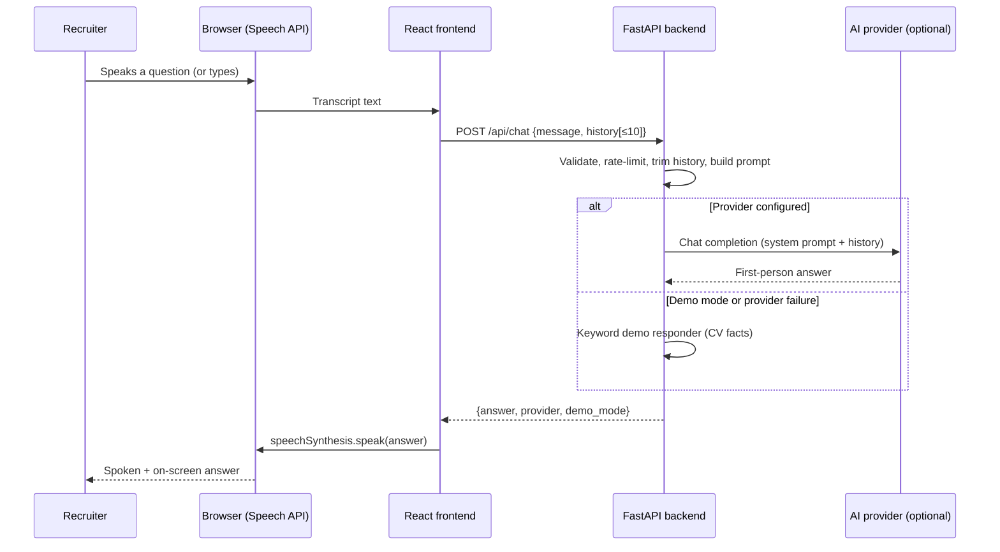

# Architecture

## Responsibilities

| Layer | Technology | Responsibility |
|---|---|---|
| Browser | Web Speech API | Speech recognition (mic → text) and speech synthesis (text → audio). Both run locally in the browser; no audio leaves the device. |
| Frontend | React 19, Vite, TypeScript, Tailwind CSS 4 | Landing page, interview UI, session state (messages, status), voice controls, accessibility, calling the backend. |
| Backend | FastAPI, Pydantic, httpx | Validates requests, limits history and size, rate-limits, builds the system prompt from the candidate profile, calls the configured AI provider or the demo responder, returns a safe answer. |
| AI provider | Google Gemini or OpenAI (optional) | Generates the first-person answer from the prompt. Replaced by the keyword demo responder when no key is configured. |

The frontend never holds an API key. The only configurable frontend value is `VITE_API_BASE_URL`.

## Request / response flow

1. The recruiter types a question or speaks it (speech recognition converts it to text in the browser).
2. `useInterview.ask()` appends the user message, sets status to `processing`, and calls `POST /api/chat` with the question and the last 10 messages.
3. FastAPI validates the body (`ChatRequest`): non-blank, ≤ 1000 characters, history roles limited to `user`/`assistant`.
4. The rate limiter checks the client IP (default 30 requests / 60 s).
5. `ChatService` trims history to `MAX_HISTORY_MESSAGES`, builds the system prompt from `candidate_profile.py`, and calls the provider.
6. If the provider fails or times out, the service degrades to the demo responder and flags `demo_mode: true` instead of returning a 5xx.
7. The frontend renders the answer, sets status to `speaking`, and speech synthesis reads it aloud (unless muted). Status returns to `idle` when playback ends.

## AI provider abstraction

`backend/app/services/llm_providers.py` defines `BaseProvider.complete(system, history, message) -> str` and three implementations: `DemoProvider`, `GeminiProvider` (REST `generateContent`), `OpenAIProvider` (REST chat completions). `build_provider(settings)` chooses based on `AI_PROVIDER` and whether a non-placeholder key exists (`Settings.effective_provider`). Adding a provider means one new class and one branch in `build_provider`.

Providers are called over plain HTTPS with `httpx`, so there is no SDK version lock-in; model names are configurable via `GEMINI_MODEL` / `OPENAI_MODEL`.

## Candidate knowledge base

`backend/app/knowledge/candidate_profile.py` is the single source of truth: summary, skills, experience, projects, education, certifications, curated first-person answers for the five assessment questions, and an explicit note about unknown topics. `profile_as_text()` renders it into the system prompt; `public_profile()` exposes only name, assistant name, headline and summary to the UI. Contact details are never sent to the browser.

The demo responder (`demo_provider.py`) uses the same data with keyword routing so that answers in demo mode and LLM mode share facts and numbers.

## Voice

- **Input:** `useSpeechRecognition` wraps `SpeechRecognition` / `webkitSpeechRecognition`. Interim results are shown live; the final transcript is submitted automatically. Permission denial, no-speech and unsupported-browser cases map to clear messages and a text fallback.
- **Output:** `useSpeechSynthesis` wraps `speechSynthesis`. Supports stop, replay of the last answer, and mute. Queued speech is cancelled before a new answer or before listening starts, so the mic never picks up the assistant's own voice.

## Session state, errors, security

- State lives in React memory only (`useInterview`). Nothing is persisted; reload or Reset clears it. The backend stores nothing.
- Backend errors are normalised to short, non-technical messages (`422`, `413`, `429`, `500`). Validation errors never echo the input.
- CORS is explicit (`CORS_ORIGINS`), methods limited to GET/POST.
- Secrets are read only from environment variables / `.env` (git-ignored). The system prompt instructs the model never to reveal configuration, and the backend never returns it.
- Rate limiting is in-memory per process; for multi-instance deployments swap `RateLimiter` for a shared store.

## Design trade-offs

- **REST over SDKs** keeps dependencies small and avoids breaking SDK changes, at the cost of hand-written request bodies.
- **Browser speech APIs** cost nothing and keep audio private, but quality and availability depend on the browser (Chrome/Edge best; Firefox has no recognition). Typing is always available.
- **Graceful degradation to demo** means a recruiter never sees a dead page when a key expires or quota runs out; the trade-off is that a degraded answer is clearly labelled rather than hidden.
- **No streaming** keeps the voice pipeline simple (speak once the full answer arrives). Answers are 50–120 words, so latency is acceptable.
